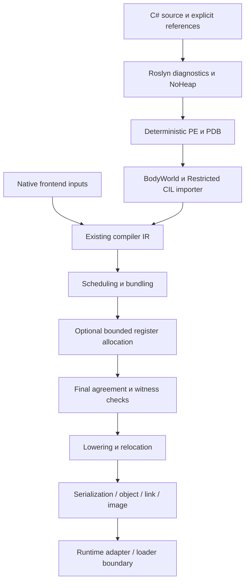

# HybridCPU Compiler — Whitebook

Редакция 9 ноября 2026. Обзор архитектуры и возможностей компилятора HybridCPU-v2. Основание — текущие source owners и [отчёт о состоянии](../HybridCPU_Compiler_vNext_Plan_v3/CURRENT_STATE_AND_PROGRESS.md). Это описание реализованного устройства и его границ, не обещание полной совместимости с C#/.NET и не release qualification.

## 1. Назначение

Компилятор преобразует поддержанные входные программы в статические артефакты для typed-slot VLIW HybridCPU-v2. Его задачи: установить допустимую статическую семантику, построить зависимости и control flow, назначить операции на ресурсы target, сформировать bundles, выполнить lowering/relocation и подготовить код с необходимыми metadata и provenance.

Основные входы — native instruction/IR path и managed PE/CIL. C# поступает через Roslyn companion, поэтому успешный синтаксический анализ или PE emit — только первая часть пути. Поддержка языка определяется тем, какие emitted IL, signatures, bodies и runtime contracts проходят downstream compiler.

Компилятор не является владельцем live legality. Даже корректный image должен быть принят и исполнен runtime/OS/provider по их собственным правилам. Статические facts, annotations и доказательства не являются capability или permission.

## 2. Целевая архитектура

Базовый контракт HybridCPU-v2 фиксирует bundle шириной W=8, 4-way SMT и architectural state 32×64-bit registers на virtual thread. Тип слота влияет на placement и legality:

| Lanes | Назначение |
|---|---|
| 0–3 | ALU |
| 4–5 | LSU |
| 6 | Shared DMA/MatrixTile |
| 7 | Branch/system |

MatrixTile LOAD/STORE используют lane6, соответствующий stream class и HardPinned contract. Это не обычные LSU операции. Компилятор обязан сохранять target facts при scheduling, bundling и physical lowering.

Этот whitebook не заменяет ISA/CPU contracts. Нормативные источники: [VLIW format](../../Documentation/WhiteBook/2.%20vliw-binary-format.md), [architectural model](../../Documentation/WhiteBook/4.%20architectural-model.md), [typed slots](../../Documentation/WhiteBook/6.%20typed-slot-scheduling.md), [compiler/runtime](../../Documentation/WhiteBook/7.%20compiler-runtime-contract.md) и [MatrixTile transport](../../Documentation/Stream%20WhiteBook/03_MatrixTile/02_Tile_Stream_Transport.md).

## 3. Путь от входа к image

Диаграмма показывает общие стадии, а не обязательный вызов одной facade каждым frontend. Canonical facade находится в Core. CIL и NativeAOT используют shared stages и сохраняют собственные ABI, EH/GC, object/link/startup/image responsibilities. Native, managed и LLVM входы не считаются автоматически семантически эквивалентными.

При source error или NoHeap violation emit не должен выдавать принятый PE. Unsupported IL должен завершить compiler refusal до object/image. Final output допускается только после проверок соответствующего пути.

## 4. Managed frontend и владение входами

Roslyn companion владеет переданными source, options и references, выполняет diagnostics/NoHeap и deterministic emit. CLI предоставляет `compile-source-image` с явными source/reference/root и output options. Default language — CSharp13; CSharp15 доступен через explicit matching SDK-host lane в поддержанных consumers.

Роли references различаются. Metadata declaration позволяет разрешать типы и сигнатуры, но не импортировать произвольное тело. Только явно выбранные body references дают BodyWorld право использовать тела dependency. Поиск DLL по filesystem/framework не заменяет input authority.

BodyWorld строит bounded closure методов, проверяет exact module/definition/signature и generic owner/method contexts. Module readers имеют scoped lifetime. Discovery обнаруживает кандидата; admission требует final semantic/typed/body proof. Это различие особенно важно для constrained generic helpers: сходство имени или carrier не доказывает nominal identity и допустимость тела.

PE/PDB maps принадлежат primary module. Dependency method token не получает primary PDB. Source, artifact, map, import/options и graph identities описывают разные отношения и не должны использоваться как взаимозаменяемые cache keys.

Основные owners: [companion](../../../Compilers/HybridCPU_Compiler/Roslyn/ManagedSourceCompanionV1.cs), [BodyWorld](../../../Compilers/HybridCPU_Compiler/Roslyn/ManagedSourceCompanionV1.BodyWorld.cs), [importer](../../../Compilers/HybridCPU_Compiler/Cil/RestrictedCilImporterV1.cs).

## 5. Семантика, типы и поддержанные C# сценарии

Importer работает с ограниченным CIL и typed control-flow/dataflow, включая CFG/SSA и budgets. Допуск зависит от exact signatures, bodies, effects, nominal types и роли метода, а не только от opcode или C# syntax.

Реализованы scalar Int32/Int64 consumers, arithmetic/branches и pure helper graphs, а также доказанные counted и некоторые nested loops. Loop bounds требуют конкретных invariant/no-wrap proofs. Возможные faults и eager evaluation нельзя удалить только потому, что результат или параметр не используется.

Для value types поддержаны immutable single-scalar конструкции, getters, factories, local copies/joins и явно выбранные external definitions. Scalar representation не превращает любой struct того же размера в допустимый nominal value. General aggregate ABI остаётся отдельной задачей.

Nullable locals покрывают primitive carriers и enum с integral underlyings. Presence/payload либо packed representation — internal lowering, не обещание общего nullable ABI. Checked `Value` использует существующий checked helper и соответствующий EH contract. Private primary non-root Nullable<int> inputs/returns и их helper graphs имеют более узкий допуск, чем local operations.

Последний принятый constrained scope: private static method `U M<U>(U...) where U:struct`, selected Int32/Int64, 1–8 exact `U` operands и `U` return, primary non-root signed contexts. Проверяются exact struct constraint, owner/method context, definition, purity, typed body и original budgets. Direct/transitive helper и generic `default(U)` local-zero body реализованы. Zero-input constrained signature пока отвергается.

Primitive arrays, String accessors и reference/argument consumers доступны в проверенных bounded формах с identity, GC/fault и layout guards. Это не общая совместимость с BCL. Полная поддержка C#, async, unsafe, interop, trimming, произвольных constraints/byref/EH и публичного nullable ABI не заявлена. Актуальная [матрица](../HybridCPU_Compiler_vNext_Plan_v3/93_ACCEPTANCE_MATRIX.md) отделяет private/local scopes от общих контрактов.

## 6. Shared backend

Backend использует существующий IR и общие механизмы scheduling, bundling, agreement и post-bundle compilation. Scheduler обязан учитывать data/control/resource dependencies и typed-slot placement. Bundling и final lowering должны сохранить эти ограничения в physical instruction stream.

Register allocation применяется как bounded post-bundle transformation. Принятый allocation требует witness, согласованных final schedule/bundles, physical operands и final relocation/agreement. Нельзя считать initial schedule достаточным доказательством после изменения размещения регистров.

Post-bundle tail выполняет mechanical lowering, разрешение control-flow relocations, annotations и serialization в зависимости от caller. Object/link/image owners добавляют свои symbol/ABI/metadata обязанности. Общая стадия backend не отменяет frontend-specific semantics.

Ключевые owners: [canonical facade](../../../Compilers/HybridCPU_Compiler/Core/Compilation/HybridCpuCanonicalCompiler.cs), [bundler](../../../Compilers/HybridCPU_Compiler/Core/IR/Compilation/HybridCpuProgramBundler.cs), [post-bundle](../../../Compilers/HybridCPU_Compiler/Core/IR/Compilation/HybridCpuPostBundleCompiler.cs), [managed object linker](../../../Compilers/HybridCPU_Compiler/Cil/ScalarControlFlowV2ObjectLinkerV1.cs).

## 7. Компоненты и integration boundaries

| Компонент | Ответственность |
|---|---|
| Core | Compiler IR, shared stages, policies, artifacts, canonical facade |
| Platform.Contracts | Общие immutable architectural facts |
| CIL | Restricted importer, managed proofs, maps и method/object path |
| Roslyn / Analyzers / Generators | Source companion, NoHeap, declaration-only incremental tooling |
| Native / LLVM | Frontend-specific inputs/mapping; LLVM coverage отдельно ограничена |
| NativeAot.Adapter | Managed ABI/EH/GC/metadata и object/link/image integration |
| Upper compiler / runtime adapter | Concrete ISE emission/transport и runtime-facing integration |
| Validation tools | Source, physical oracle, scheduler и release evidence consumers |

Core зависит от общих contracts и не должен получать обратную зависимость от concrete ISE или CIL implementation. Selective compile groups upper проекта намеренно отделяют compiling owners. Root solution не является исчерпывающим списком tooling graphs; actual evaluated project properties нужны для каждой проверяемой сборки.

Concrete runtime adapter проверяет transport requirements и выполняет runtime-facing emission, memory/annotation/fetch operations своего scope. Compiler-only compilation не выполняет эти действия. NativeAOT target artifacts, compiler host AOT и runtime publication — разные направления.

## 8. Policies, профиль и воспроизводимость

Scheduling/bundling/composite policies и output-affecting options имеют immutable/versioned identities. Profile-guided compile — explicit opt-in, default-off lane. Metrics/resource/topology shadow paths наблюдают работу; наблюдение не должно становиться скрытым selector.

Детерминированный profile result означает повторяемость при определённых inputs/options, но не доказанное ускорение. Performance promotion требует benchmark с объявленной baseline и измерением времени/ресурсов/качества результата. Persistent cache, daemon и concurrent session не возникают автоматически из наличия digests; им нужны lifetime, invalidation, cancellation и reuse contracts.

Default companion Roslyn и SDK-host lane используют отдельные products/references. Root SDK pin описывает compiler tooling, не guest BCL support. Смена package/language/SDK — отдельное compatibility change. Точные pins хранятся в [global.json](../../../global.json) и [toolchain policy](../HybridCPU_Compiler_vNext_Plan_v3/98_ROSLYN_DOTNET11_CSHARP15_POLICY.md), а не дублируются в этом whitebook.

## 9. Как доказывается работоспособность

Проверка consumer должна пройти весь заявленный путь. Source positive/negative и NoHeap дополняются emitted IL/metadata oracle, importer/backend result и exact artifacts. Deterministic PE/PDB/maps/image repeat проверяется отдельно от semantic equivalence разных source forms.

Независимые scalar/CoreCLR и encoded/serialized physical oracles проверяют результаты и ABI. Нужны extrema/high-bit/overflow, presence/null, eager evaluation/call counts и applicable role/identity/effect/EH/byref/budget/fault/cancel/reuse/precedence negatives. Успешная строка в логе полезна только в рамках реально выполненных assertions.

Основные existing harnesses — CompilerProfileSmoke и ManagedPortSmoke. Shared managed changes требуют applicable default/SDK source lanes и full Managed regression. Scheduler или runtime contracts требуют дополнительных соответствующих нагрузок. Новая campaign должна иметь fresh isolated outputs, actual commands/exits и input/evaluated hashes. Failed attempts сохраняются как failures.

Последний сохранённый acceptance v137 от 24 октября: default profile426/SDK427/Managed433 PASS-строки, все exit0; focused48 source и48 новых physical cases. 9 ноября manifests сопоставлены с source без drift. Это не новый запуск и не qualification всех входов или окружений. Подробности, включая неудачную слишком сильную I8 byte-equality проверку, находятся в [immutable report](../../../TempEnv/doom-continuation-20260905/scalar-default-20261024/REPORT.md).

## 10. Степень готовности и развитие

Связный compiler foundation и ограниченные source→image consumers реализованы. Следующая работа расширяет конкретную семантику поверх existing owners; общий rewrite IR/importer/backend не следует из оставшихся gaps.

Ближайший consumer — zero-input constrained scalar helper. Единственная изменяемая очередь находится в [95](../HybridCPU_Compiler_vNext_Plan_v3/95_IMPLEMENTATION_ORDER_AND_COMMITS.md); whitebook не создаёт конкурирующий backlog. Более широкие generic/ABI/language/target и performance claims требуют своих проверок.

Общая qualification остаётся неподтверждённой. Release component PASS не доказывает full solution/Debug, ordinary-host stability, loader/guest/replay, independent clean builds или publication. Структурный release validator не исполняет заявленную программу. Compiler artifact, runtime admission, execution, retire и OS publication должны иметь отдельные доказательства.

Для работы с кодом: [source index](../HybridCPU_Compiler_vNext_Plan_v3/94_SOURCE_INDEX.md). Для фактического прогресса и применимости evidence: [отчёт](../HybridCPU_Compiler_vNext_Plan_v3/CURRENT_STATE_AND_PROGRESS.md) и [00](../HybridCPU_Compiler_vNext_Plan_v3/00_CODE_VERIFICATION_REPORT.md).
