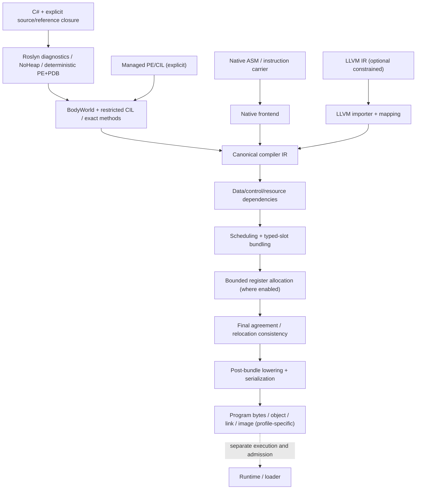

# HybridCPU Compiler — Whitebook

**Актуализация: 11 ноября 2026.** Source-anchored архитектура и функциональные границы [HybridCPU-Compilers](https://github.com/yuriyyak23/HybridCPU-Compilers), проверенный `master`: `06700ff9a7c650be60ea6a85783f29acdd4f2b9b`. Документ описывает фактических source owners и действующие ограничения; не является заявлением о полном C#/.NET, единой production qualification, универсальном NativeAOT или C#→RTL.

> **Навигация:** [корневой README](../../../README.md) · [source owners и зависимости](SOURCE_OWNERS_AND_BOUNDARIES.md) · [HardwareBridge и CircuitWeave](HARDWAREBRIDGE_AND_CIRCUITWEAVE.md) · [сборка, тесты и release evidence](BUILD_TEST_AND_RELEASE.md).

**Важно о разделении репозиториев:** после выделения `HybridCPU-Compilers` старый Whitebook содержал ссылки на `Documentation/Compilers/HybridCPU_Compiler_vNext_Plan_v3`, `Documentation/WhiteBook` и `global.json`, которых **нет в текущем дереве этого репозитория**. Эти ссылки не являются локальными нормативными документами и удалены. Отдельная ISA/ISE спецификация остаётся внешним источником, который следует привязывать к конкретному SHA, если он нужен для верификации.

## 1. Назначение и границы

HybridCPU Compilers — семейство frontend и общих стадий компилятора **программ** для typed-slot VLIW архитектуры HybridCPU. Он принимает явно определённые source/PE/CIL, ASM/carrier либо ограниченный LLVM IR; строит контролируемое промежуточное представление, зависимости/расписание, bundle placement, machine-specific lowering и подходящие артефакты.

Компилятор:
- проверяет закрытое допустимое подмножество операций, ABI, exact type/method identities и input ownership;
- сохраняет target resource/slot legality и детерминированные contracts;
- производит код, metadata, identity и ограниченный object/link/image output;
- **не** устанавливает runtime capability, loader admission, фактическое исполнение, VM/OS publication, commit/retire либо hardware equivalence одним фактом успешной сборки.

Входной C# сначала компилируется Roslyn в deterministic PE/PDB. Только **допущенный** bounded CIL/managed graph становится кандидатом на создание HybridCPU image. Изменение Host .NET 11, синтаксическая допустимость C# 15 или успешная генерация PE **не** расширяют сами собой guest ABI/BCL.

## 2. Архитектура целевой машины

Версионированная структурная модель зафиксирована в [`HybridCpuMachineDescriptionV1`](../../../Compilers/HybridCPU_Compiler/Core/IR/Resources/HybridCpuMachineDescriptionV1.cs), contract v6 — в [`HybridCpuCompilerContracts`](../../../Compilers/HybridCPU_Compiler/Core/IR/Model/HybridCpuCompilerContracts.cs). Target width: **8 slots per VLIW bundle**; architectural SMT: **4 virtual threads**. Базовые назначения:

| Физические lanes | Слот/операции | Важная граница |
|---|---|---|
| 0–3 | ALU / scalar | Могут иметь собственные capacity и dependency restrictions |
| 4–5 | LSU | Memory hazards и ресурсы учитываются отдельно |
| 6 | Shared DMA / MatrixTile | Операции Tile/Stream используют специальные классы, binding и ограничения placement; не эквивалентны обычному LSU |
| 7 | Branch / system | Control/privileged capabilities, deferred ABI, target legality |

Compiler-side topology snapshot описывает **ожидаемую** статическую машину. Runtime topology — отдельный parity oracle, не mutable объект, из которого Core молча выводит права. Корректность image определяется **в рамках выбранного frontend/target/runtime contract**.

## 3. Основной путь компиляции

Это схема **сопоставления стадий**, а не обещание, что все frontend вызывают один универсальный фасад. Общий owner — [`HybridCpuCanonicalCompiler`](../../../Compilers/HybridCPU_Compiler/Core/Compilation/HybridCpuCanonicalCompiler.cs) и [post-bundle compilation](../../../Compilers/HybridCPU_Compiler/Core/IR/Compilation/HybridCpuPostBundleCompiler.cs). Управление object/relocation/link/runtime metadata остаётся у соответствующих caller/target компонентов. Source-to-image результат нельзя считать эквивалентным NativeAOT-only либо LLVM-only workflow без отдельной проверки.

## 4. Модули и dependency direction

| Модуль | Основные владельцы | Контракт |
|---|---|---|
| Platform.Contracts | [`HybridCPU.Platform.Contracts`](../../../Compilers/HybridCPU_Platform.Contracts/) | Общие immutable machine/ABI facts |
| Core | [`Core`](../../../Compilers/HybridCPU_Compiler/Core/) | Canonical IR, hazards, resource model, schedule, bundle, serialize |
| Native | [`NativeCompilerFrontends`](../../../Compilers/HybridCPU_Compiler/Native/NativeCompilerFrontends.cs) | ASM/carrier import и проверенные native artifacts |
| LLVM | [`LlvmModuleImporterV1`](../../../Compilers/HybridCPU_Compiler/LLVM/LlvmModuleImporterV1.cs) | Ограниченный LLVM IR, explicit semantic mapping |
| Roslyn | [`ManagedSourceCompanionV1`](../../../Compilers/HybridCPU_Compiler/Roslyn/ManagedSourceCompanionV1.cs) | Owned C# source, diagnostics/NoHeap, deterministic emit, BodyWorld |
| Analyzers/Generators | [`KernelNoHeapAnalyzer`](../../../Compilers/HybridCPU_Compiler/Analyzers/KernelNoHeapAnalyzer.cs), [`StaticContractGenerator`](../../../Compilers/HybridCPU_Compiler/Generators/StaticContractGenerator.cs) | Admit/diagnostic и source-generated contracts, не rewrite произвольной программы |
| CIL | [`RestrictedCilImporterV1`](../../../Compilers/HybridCPU_Compiler/Cil/RestrictedCilImporterV1.cs) | Точное CIL/type/body admission, CFG, SSA и managed ownership |
| NativeAOT.Adapter | [target enablement](../../../Compilers/HybridCPU_Compiler/NativeAot/PHASE23_TARGET_ENABLEMENT_MAP.md) | Pinned ILCompiler seam, HCO/link/image, отдельно от host RyuJIT |
| RuntimeKernel / ManagedRuntime | [kernel](../../../Compilers/HybridCPU_RuntimeKernel/), [managed runtime](../../../Compilers/HybridCPU_ManagedRuntime/) | Runtime component contracts; не превращаются в publish без loader evidence |
| Oracle / Profiles | [exact scheduler](../../../Compilers/HybridCPU_Compiler/Oracle/HybridCpuEnumerativeExactOracleV1.cs), [profiles](../../../Compilers/HybridCPU_Compiler/Profiles/) | Проверка расписаний и advisory/profile metadata |
| ReleaseQualification | [release contract](../../../Compilers/HybridCPU_Compiler/ReleaseQualification/PHASE27_RELEASE_V1.md) | End-user профиль и outward-only manifest, не второй компилятор |
| HardwareBridge (opt-in) | [bridge](../../../Compilers/HybridCPU_Compiler/HardwareBridge/Docs/README.md) | Read-only software provenance и bounded Golden observations |
| Upper integration / CPU bridge | [upper project](../../../Compilers/HybridCPU_Compiler/HybridCPU_Compiler.csproj), [interface bridge](../../../Compilers/CpuInterfaceBridge/) | Concrete external ISE references / runtime transport / diagnostics |

Core не должен зависеть от concrete ISE или frontend implementation. Вверх по слоям разрешены вызовы shared IR/stages, вниз — нет обратного владения. Полная карта source ownership и внешних зависимостей: [SOURCE_OWNERS_AND_BOUNDARIES](SOURCE_OWNERS_AND_BOUNDARIES.md).

## 5. Roslyn source companion: точные входы и identity

[Документация Roslyn](../../../Compilers/HybridCPU_Compiler/Roslyn/README.md) является source-level contract для фактического CLI. Default: package `Microsoft.CodeAnalysis.CSharp 4.14.0`, `CSharp13`, `net11.0`. `CSharp15` только при explicit matching SDK host, а не в пакете Roslyn по умолчанию. Не переносить исторический NativeAOT SDK 10.x pin на основной компилятор.

`CompanionSourceRequestV1` получает явные документы и reference images. Owned source является моментальным неизменяемым снимком; diagnostics/NoHeap проходят до emit. В `compile-source-image` допускаются repeatable `--source`/`--reference`, объявленные root type/method и output. Три роли references:

| Роль | Семантика |
|---|---|
| Primary PE/PDB | Созданный Roslyn output и source maps только для принадлежащего ему primary module |
| Body reference | Явно выбранная dependency image с правом импортировать конкретные методы и их transitive closure |
| Metadata-only reference | Объявления типов/сигнатур без права импортировать их method bodies |

Сходство имени, generic carrier, nominal layout или filename не доказывает принадлежность метода source/definition. BodyWorld и CIL должны проверить exact declaring type/method token, arity, closed generic contexts, definition identity и собственный вызов closure. Primary PDB нельзя использовать для dependency methods.

Различные digests имеют **разные области**: `SourceInputDigest` описывает source/emit input, `CompanionArtifactIdentityV1` — точные PE/PDB outputs, import/options/graph identities — реальные selected roots и call closure, HardwareBridge `SnapshotDigest` — отдельный sidecar preimage. Нельзя объявлять один digest синонимом другого.

## 6. Restricted CIL и особенности C# subset

[Importer](../../../Compilers/HybridCPU_Compiler/Cil/RestrictedCilImporterV1.cs) — не общий CLR и не C# interpreter. Поддержка определяется иерархией **допустимых emitted CIL patterns**, exact nominal types, effects, ABI и runtime helper contracts.

В реально реализованных bounded slices присутствуют:
- Int32/Int64 scalar operations, arithmetic, branches, CFG/SSA/phi, selected finite loops и чистые helper call graphs;
- validated direct/mutual bounded recursion только под явными constraints;
- конкретные enum/value shape/nullable, primitive arrays, string literals/accessors, selected managed EH/GC/reference component contracts;
- tightly controlled exact closed generics, call signatures, dispatch, allocations и managed object behaviors в соответствующих **компонентных** профилях.

**Не следует обобщать** наличие теста или класса на полный .NET: arbitrary assemblies, filesystem/runtime reflection, async/Task, unsafe, P/Invoke, BCL, open generics, general EH, unmanaged resources и сложные heap graphs требуют отдельного admission и qualified runtime path. Некоторые возможности имеют статус *component only/default-off* и не доступны для image publication. По отдельным CIL случаям authoritative являются код импортера, [ManagedPortSmoke](../../../Compilers/HybridCPU_Compiler/Tools/ManagedPortSmoke/README.md) и profile-gated test fixtures.

Примеры отказов: отсутствующая implementation-bearing dependency, unsupported CIL opcode/signature, unknown helper effect, ambiguous method selector, invalid identity/PDB ownership, неустановленная bound/overflow safety, no target slot или missing ABI layout.

## 7. Native frontend и LLVM

[Native carrier/assembly frontend](../../../Compilers/HybridCPU_Compiler/Native/NativeCompilerFrontends.cs) имеет bounded input, explicit source/producer/build identity, typed-slot legality, reproducible artifacts и refusal for invalid instructions/placement. Это самостоятельный путь к shared Core, не общая ELF/RISC-V либо GCC-compatible assembler.

[LLVM importer](../../../Compilers/HybridCPU_Compiler/LLVM/LlvmModuleImporterV1.cs) и [semantic mapper](../../../Compilers/HybridCPU_Compiler/LLVM/LlvmSemanticMappingV1.cs) используют LLVMSharp с versioned toolchain/target contracts. Structural success не означает semantic equivalence. Неподдержанные instruction semantics должны получить `Unsupported`/`UnknownSemantics` до мнимого Canonical IR. Это optional/default-off профиль без самостоятельной власти над scheduling, output или runtime.

## 8. Scheduling, bundling и physical backend

Shared Core включает:
- canonical IR records/operands/source/target and control-flow contracts;
- DAG и data/control/resource dependency analysis;
- local/region/modulo scheduling с explicit budgets, target topology/capacity и profile opt-in;
- typed-slot bundling, label/control flow relocation, strict legality and late lane binding;
- bounded post-bundle register allocation, liveness/pressure и final schedule/allocation agreement;
- exact target serialization, annotations, provenance/metrics.

**Final agreement после allocation важнее одного pre-allocation schedule.** Изменения physical registers, bundling и relocation должны быть согласованы с final emitted stream. Telemetry/profile data не должны незаметно менять non-profile default output. Deterministic output и одинаковые hashes сами по себе не доказывают ускорение, compiler correctness или runtime execution.

Sources: [IR model](../../../Compilers/HybridCPU_Compiler/Core/IR/Model/), [machine resource model](../../../Compilers/HybridCPU_Compiler/Core/IR/Resources/), [program bundler](../../../Compilers/HybridCPU_Compiler/Core/IR/Compilation/HybridCpuProgramBundler.cs), [register allocator](../../../Compilers/HybridCPU_Compiler/Core/IR/Allocation/HybridCpuScheduleAwareRegisterAllocatorV1.cs).

## 9. Object/link/image и NativeAOT target

[HCO v1](../../../Compilers/HybridCPU_Compiler/NativeAot/PHASE24_OBJECT_FORMAT_HCO_V1.md) — compiler-owned relocatable container с `HCOBJ001` magic, little-endian, deterministic checksum и bundle alignment. [Restricted HCEXE](../../../Compilers/HybridCPU_Compiler/NativeAot/PHASE24_RUNNABLE_RESTRICTED_IMAGE_V1.md) — отдельный image-level contract; наличие object не доказывает linker/startup или managed runtime.

[Phase 23](../../../Compilers/HybridCPU_Compiler/NativeAot/PHASE23_TARGET_ENABLEMENT_MAP.md) описывает patched upstream `ILCompiler`: graph-selected single-method seam; не переименовывает существующий x64 backend в HybridCPU; target identity/ABI/objects остаются проверяемыми. [Phase 26](../../../Compilers/HybridCPU_Compiler/NativeAot/Packaging/PHASE26_SDK_PACK_V1.md) ограничивает `hybridcpu` custom RID, exact pack/patch/binary identities и соответствующую SDK/host комбинацию. Это **не** обещание полной `dotnet publish` совместимости с любым проектом.

Host compiler .NET 11, pin упомянутого upstream ILCompiler .NET 10 SDK/source, отдельный publish SDK и target runtime pack — **разные сущности**. Каждая требует собственной reproducibility и license/build verification. [Демонстрационный restricted AOT corpus](../../../Diagnostics/HybridCpuAotAddDemo/README.md) намеренно различает реальные узкие images и host-only component showcase.

## 10. Managed runtime как отдельный набор контрактов

[RuntimeKernel](../../../Compilers/HybridCPU_RuntimeKernel/) и [ManagedRuntime](../../../Compilers/HybridCPU_ManagedRuntime/) содержат работу с object/GC/dispatch/EH/thread-related abstractions в соответствующих компонентах. Отдельные validated slices **не равны** full managed-runtime publishing. Точный списочный owner feature subsets: [Phase 25](../../../Compilers/HybridCPU_Compiler/NativeAot/PHASE25_MANAGED_FEATURE_SET_V1.md), [pack contract](../../../Compilers/HybridCPU_Compiler/NativeAot/Packaging/PHASE26_SDK_PACK_V1.md) и [Release v1](../../../Compilers/HybridCPU_Compiler/ReleaseQualification/PHASE27_RELEASE_V1.md).

Loader, guest execution, scheduler live state, GC under real execution, OS publication, commit/retire и runtime provider permissions квалифицируются независимо. **Host execution of component tests is not guest execution.**

## 11. HardwareBridge и граница C#→RTL

В `master` уже реализован **opt-in HardwareBridge v1** под [HardwareBridge/](../../../Compilers/HybridCPU_Compiler/HardwareBridge/). Он экспортирует три read-only категории:

1. `SourceSnapshot`: exact caller-supplied sources/reference roles/roots, ordered hashes, virtual paths и bridge-specific snapshot digest.
2. `CompilerFacts`: projection существующего Roslyn Companion/Restricted CIL body graph, PE/PDB/source mapping и diagnostic refusal; typed adapter находится в opt-in companion project.
3. `GoldenOracle`: bounded synchronous **explicitly trusted** AddWord32 delegate и bit-pattern observations, status `Observed` или `Blocked`.

[HardwareBridge sidecar v1](../../../Compilers/HybridCPU_Compiler/HardwareBridge/Docs/sidecar-v1.md) — собственный versioned diagnostic JSON envelope с `PayloadSha256`. Его self-check/hash **не** является криптографической подписью, permission, accepted binding, RTL proof или заключением о clock/latency/reset/memory.

**Разделение обязанностей:** Hardware Attributes объявляют аппаратное намерение; Hardware Bindings устанавливают проверяемую связь Golden source и hardware contract; `HwComponent` описывает структуру схемы. **Все три аппаратных механизма, HWIR, CIRCT, IP, EDA ToolBridge и независимая verification authority принадлежат отдельному [CircuitWeave](https://github.com/yuriyyak23/CircuitWeave).** Studio [CircuitWeave-Studio](https://github.com/yuriyyak23/CircuitWeave-Studio) потребляет опубликованные read-only artifacts, не повышая их статус.

Подробные свойства экспортера, host trust boundaries и пример sidecar: [HARDWAREBRIDGE_AND_CIRCUITWEAVE](HARDWAREBRIDGE_AND_CIRCUITWEAVE.md).

## 12. Compiler authority и безопасность

| Что произошло | Что **не** доказано этим фактом |
|---|---|
| C# распарсен | CIL допущен |
| PE/PDB сгенерированы | Импортирована полная owned body closure |
| CIL importer вернул graph | Выполнен physical bundling/link/runtime admission |
| Native/LLVM instruction признана структурной | Её семантика равна guest machine |
| HCO/HCEXE создан | Реальный loader запустил, выполнил и завершил image |
| Sidecar hash совпал | Подлинность Golden, hardware binding, RTL equivalence |
| Unit/component smoke PASS | Наличие независимых clean builds, production-release/capability |
| Resource/profile telemetry собрана | Улучшение throughput/latency или право выбора policy |

Практическое правило: каждый stage явно сообщает собственный refusal/diagnostics; непроверенное evidence = `NotRun`/`Unqualified`/`Blocked` в соответствующем consumer, а не «verified by default».

## 13. Тесты, детерминизм и proof scope

Компилятор имеет project-scoped [xUnit suite](../../../Tests/HybridCPU.Compiler.Tests.csproj), [CompilerProfileSmoke](../../../Compilers/HybridCPU_Compiler/Tools/CompilerProfileSmoke/) и [ManagedPortSmoke](../../../Compilers/HybridCPU_Compiler/Tools/ManagedPortSmoke/README.md). HardwareBridge имеет собственный [isolated self-test project](../../../Compilers/HybridCPU_Compiler/HardwareBridge/Tests/README.md). Демонстрации, NativeAOT pack scripts и [ReleaseQualification](../../../Compilers/HybridCPU_Compiler/ReleaseQualification/README.md) имеют **разные** test/validation authorities.

Оптимальная независимая campaign фиксирует исходную ревизию, SDK/package host/ILCompiler, exact references/roots/target policies, fresh output roots, commands/exits, SHA-256 outputs, source maps, separate positive/negative/role/effect/ABI/cancellation/provenance controls. PE/PDB/image byte identity проверяется отдельно от behavior.

Архивные smoke evidence из исторических записей не становятся «сегодняшним PASS» после переноса репозитория. **На этой ревизии docs-аудит не выполнял local .NET 11 compilation или external ISE runtime.** Инструкции и условия: [BUILD_TEST_AND_RELEASE](BUILD_TEST_AND_RELEASE.md).

## 14. Степень готовности и реальная карта релиза

[Phase 27 release contract](../../../Compilers/HybridCPU_Compiler/ReleaseQualification/PHASE27_RELEASE_V1.md) **различает профили**:

| Профиль | Состояние по его source contract | Не распространяется на |
|---|---|---|
| `HybridCPU.Native` | Release-authorized в указанном Native ASM/carrier scope | Неизвестные extensions и full guest runtime |
| `HybridCPU.LLVM` | Verified optional/default-off ограниченный ingress | Shared schedule/output authority, произвольный LLVM |
| `HybridCPU.DotNetAot.Restricted` | Release-authorized узкий value-only single static method custom-RID pack при exact pinned host/SDK | Полную C#/.NET публикацию |
| `HybridCPU.DotNetAot.Managed` | Unsupported end-to-end publish | Обобщение component GC/EH/dispatch tests |
| `HybridCPU.Full` | Unsupported umbrella profile | Произвольный CPU/OS/runtime/workstream |

Здесь «release-authorized» — **термин и scoped disposition уже существующего manifest contract**, а не моё заявление, что весь текущий checkout прошёл clean-build и native/guest verification.

Более широкие планы не следует превращать в отдельную независимую очередь в Whitebook: они должны зависеть от проверенных source owners, actual failing cases, API compatibility и доказательств. Не добавлять второй CIL importer, VLIW compiler, hardware RTL backend или verification authority в этот repo.

## 15. Приложения и актуальные ссылки

- [Реальная карта проектов и source owners](SOURCE_OWNERS_AND_BOUNDARIES.md)
- [HardwareBridge v1: sidecar, Golden, взаимодействие с CircuitWeave](HARDWAREBRIDGE_AND_CIRCUITWEAVE.md)
- [Build, smoke, exact evidence и release gates](BUILD_TEST_AND_RELEASE.md)
- [Roslyn CLI / C# 13–15 language lanes](../../../Compilers/HybridCPU_Compiler/Roslyn/README.md)
- [CIL importer](../../../Compilers/HybridCPU_Compiler/Cil/RestrictedCilImporterV1.cs)
- [NativeAOT source integration and patch boundaries](../../../Compilers/HybridCPU_Compiler/NativeAot/PHASE23_TARGET_ENABLEMENT_MAP.md)
- [Managed feature set](../../../Compilers/HybridCPU_Compiler/NativeAot/PHASE25_MANAGED_FEATURE_SET_V1.md)
- [Release qualification contract](../../../Compilers/HybridCPU_Compiler/ReleaseQualification/PHASE27_RELEASE_V1.md)

**Источник статуса:** перечисленные классы, csproj и checked-in documents в ревизии выше. Любое новое утверждение о compiler support требует повторной проверки текущего code + tests + observed run evidence; README/Whitebook не могут подменять эту проверку.
