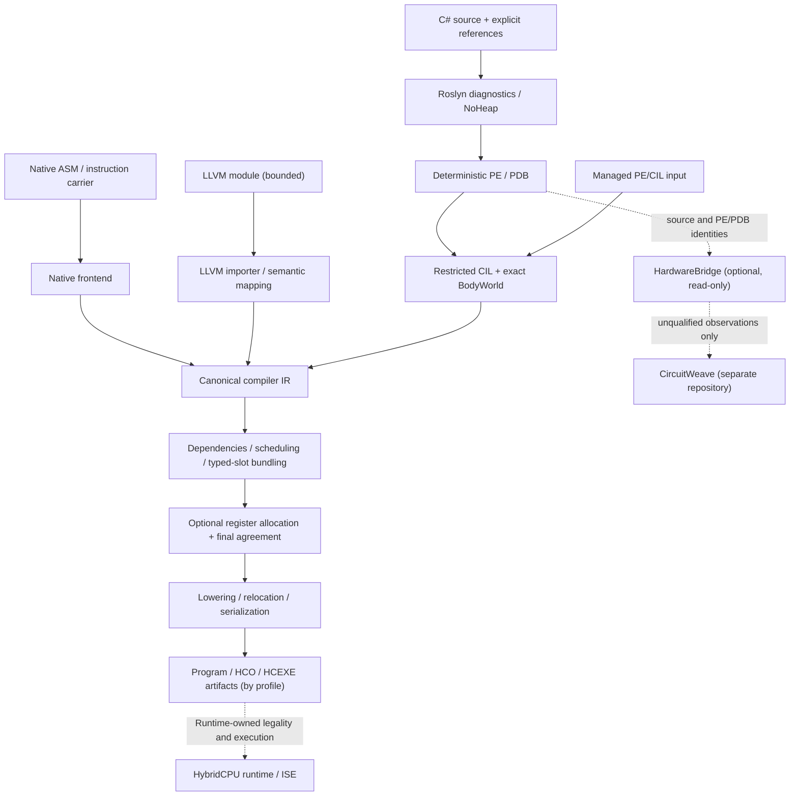

# HybridCPU Compilers

**Compiler toolchain for the HybridCPU typed-slot VLIW architecture** — native assembly/carrier inputs, bounded LLVM IR ingress, a Roslyn → restricted CIL route for selected C# programs, and a separately scoped NativeAOT target/SDK-pack path.

> **Status:** research/development compiler with versioned, selectively qualified *components and profiles*. This repository does **not** claim general .NET/C# compatibility, standalone production publishing, or qualification of all code paths. Read [Whitebook: architecture and boundaries](Documentation/Compilers/Whitebook/README.md) and [build/evidence guidance](Documentation/Compilers/Whitebook/BUILD_TEST_AND_RELEASE.md) before relying on generated images.
>
> **Platform:** compiler projects target **.NET 11**. The default Roslyn companion uses Microsoft.CodeAnalysis.CSharp **4.14.0** and **C# 13**; an explicitly selected, matching SDK-Roslyn host is needed for the gated **C# 15** lane. The separately patched NativeAOT/ILCompiler toolchain has **its own .NET 10 source/SDK pins**. The host TFM does not imply supported guest .NET 11 APIs.

## What this project does

HybridCPU Compilers transforms **admitted** program inputs into deterministic compiler artifacts for HybridCPU. It checks target-specific legality, analyzes dependencies, schedules operations, groups them into VLIW bundles and performs physical lowering/relocation, serialization and — in supported paths — object/link/image construction.

The target machine has **8 issue lanes** (ALU 0–3; LSU 4–5; shared DMA/MatrixTile 6; branch/system 7), with architectural **4-way SMT**. Target legality is encoded in versioned compiler contracts, not inferred from the host's CPU or runtime. [Machine description](Compilers/HybridCPU_Compiler/Core/IR/Resources/HybridCpuMachineDescriptionV1.cs) and [compiler contract v6](Compilers/HybridCPU_Compiler/Core/IR/Model/HybridCpuCompilerContracts.cs) are source owners.

**This is primarily a software compiler for the HybridCPU ISA, not a C# → Verilog/RTL compiler.** The small, opt-in [HardwareBridge](Compilers/HybridCPU_Compiler/HardwareBridge/Docs/README.md) exports read-only software provenance and trusted Golden observations for a *separate* hardware compiler, [CircuitWeave](https://github.com/yuriyyak23/CircuitWeave).

## Architecture



This is a **conceptual overview**: the frontend entry points, supported subsets, export formats and target profiles differ. An import or successful PE emit does **not** automatically authorize an image. Core has a [canonical compilation facade](Compilers/HybridCPU_Compiler/Core/Compilation/HybridCpuCanonicalCompiler.cs); language-specific code retains the responsibility for exact ABI, source closure and import policy.

## Compiler routes

| Route | Source owner | What it provides | Important limitation |
|---|---|---|---|
| Native ASM / carrier | [Native](Compilers/HybridCPU_Compiler/Native/NativeCompilerFrontends.cs) | Typed VLIW carrier, assembly input, native artifacts and provenance | Not arbitrary assembler/ISA compatibility; validated against target model |
| Shared core | [Core](Compilers/HybridCPU_Compiler/Core/Compilation/HybridCpuCanonicalCompiler.cs) | Canonical IR, resource model, scheduling, bundling, output stages | Cannot replace frontend-specific ABI, metadata or runtime admission |
| LLVM | [LLVM](Compilers/HybridCPU_Compiler/LLVM/LlvmModuleImporterV1.cs) | Restricted LLVM IR import and explicit semantic mapping | Optional/default-off; unsupported LLVM operations must refuse |
| C# / Roslyn | [Roslyn](Compilers/HybridCPU_Compiler/Roslyn/README.md) | NoHeap, deterministic PE/PDB, owned-source graph and CLI | C# parsing != supported CIL/body/world |
| Managed PE / CIL | [CIL](Compilers/HybridCPU_Compiler/Cil/RestrictedCilImporterV1.cs) | Bounded IL, CFG/SSA, method closure, selected managed semantics | No arbitrary BCL, runtime, generics or interop coverage |
| NativeAOT / object-image | [NativeAOT](Compilers/HybridCPU_Compiler/NativeAot/PHASE23_TARGET_ENABLEMENT_MAP.md) | Restricted patched ILCompiler seam, HCO/link/HCEXE and explicit SDK-pack | Requires separately pinned toolchain; broad managed AOT unsupported |
| HardwareBridge | [Bridge docs](Compilers/HybridCPU_Compiler/HardwareBridge/Docs/sidecar-v1.md) | Read-only source snapshot, compiler facts, trusted scalar Golden observations | Not Hardware Bindings, HWIR, RTL or proof |
| Release manifests | [ReleaseQualification](Compilers/HybridCPU_Compiler/ReleaseQualification/PHASE27_RELEASE_V1.md) | Per-profile feature matrix, deterministic manifests, structural checks | Validation != two clean builds, execution, loader or publication authority |

The solution also contains [Platform.Contracts](Compilers/HybridCPU_Platform.Contracts/), [RuntimeKernel](Compilers/HybridCPU_RuntimeKernel/), [ManagedRuntime](Compilers/HybridCPU_ManagedRuntime/), [CpuInterfaceBridge](Compilers/CpuInterfaceBridge/Diagnostics/README.md), [ConsoleNetCompiler](Compilers/ConsoleNetCompiler/), diagnostic applications, corpora and test harnesses. They do not all share a single release/qualification status.

## Getting started

### Prerequisites and checkout layout

Install a suitable **.NET 11 SDK**, then inspect the installed version with `dotnet --info`. There is **no repository-root `global.json` in this checkout**; do not infer a pinned SDK version solely from historical reports or from the NativeAOT pack documents. Some NuGet/native dependencies and independently pinned SDK assets are needed for specific routes.

The standalone Core/Roslyn/CIL projects can be addressed directly. The **upper** `HybridCPU_Compiler.csproj`, `CpuInterfaceBridge` and root test project reference an **external sibling** ISE project using an exact relative path. For those builds, provide the expected checkout layout:

```text
workspace/
├── HybridCPU-Compilers/
│   ├── HybridCPU Compilers.slnx
│   ├── Compilers/
│   └── Tests/
└── HybridCPU ISE/
    └── HybridCPU_ISE/
        └── HybridCPU_ISE.csproj
```

The ISE source is not bundled in this repository. The separately maintained [HybridCPU-v2](https://github.com/yuriyyak23/HybridCPU-v2) project provides context, but verify its current layout and revision independently. **Do not substitute an arbitrary project file** to make the build pass.

### Build a scoped compiler project

```bash
# From the HybridCPU-Compilers repository root:
dotnet --info
dotnet build Compilers/HybridCPU_Compiler/Core/HybridCPU.Compiler.Core.csproj -c Release
dotnet build Compilers/HybridCPU_Compiler/Cil/HybridCPU.Compiler.Cil.csproj -c Release
dotnet build Compilers/HybridCPU_Compiler/Roslyn/HybridCPU.Compiler.Roslyn.csproj -c Release
```

These commands are project-scoped starting points, **not a claim of an independently executed clean build**. Building `HybridCPU Compilers.slnx` or running all tests may additionally require the sibling ISE, .NET SDK/toolchain identity, external dependencies and native prerequisites. See the [build matrix](Documentation/Compilers/Whitebook/BUILD_TEST_AND_RELEASE.md).

### C# source → restricted HybridCPU image

The Roslyn companion has a CLI; **caller-supplied references are mandatory**. It does not search the filesystem for an arbitrary missing dependency:

```bash
dotnet run --project Compilers/HybridCPU_Compiler/Roslyn/HybridCPU.Compiler.Roslyn.csproj -c Release -- \
  compile-source-image \
  --source path/to/Program.cs \
  --reference path/to/required-runtime-reference.dll \
  --assembly-name Example \
  --type Example \
  --method Read \
  --out output/Example.hcexe
```

The source must actually contain the named and supported method and a complete admitted closure. Repeat `--source` / `--reference`; select implementation-bearing dependencies using `--body-reference` and declarations-only dependencies via `--metadata-reference`. Optional `--emit-pe`, `--emit-pdb` and `--emit-map` export owned source artifacts. Explicit `--language csharp15` is allowed **only** with the matching SDK-Roslyn host; default is C# 13. Read the full [CLI contract, limits and exit statuses](Compilers/HybridCPU_Compiler/Roslyn/README.md) before adapting the example.

The resulting file is a target artifact, **not a normal executable to run directly on the host OS**. Loader/execution and observable runtime correctness require separate checks.

### HardwareBridge (read-only, opt-in)

The bridge is intentionally small, independent of CircuitWeave and not loaded through an arbitrary JSON-specified assembly. It has a dedicated project because the upper compiler does not reference the Roslyn/CIL projects:

```bash
dotnet build Compilers/HybridCPU_Compiler/HardwareBridge/HardwareBridge.Companion.csproj -c Release
dotnet run --project Compilers/HybridCPU_Compiler/HardwareBridge/Tests/HardwareBridge.SelfTests.csproj -c Release
```

The [sidecar v1](Compilers/HybridCPU_Compiler/HardwareBridge/Docs/sidecar-v1.md) exports source snapshot identities, admissible compiler facts and optional **explicitly trusted** AddWord32 observations. `Candidate` and `Observed` are *not* hardware verification results. Downstream binding, HWIR, CIRCT, EDA execution and evidence authority belong to CircuitWeave. See [Whitebook: bridge boundary](Documentation/Compilers/Whitebook/HARDWAREBRIDGE_AND_CIRCUITWEAVE.md).

## Verification, reproducibility and release

```bash
# Scoped smoke / tests — run only with the relevant prerequisites:
dotnet run --project Compilers/HybridCPU_Compiler/Tools/CompilerProfileSmoke/CompilerProfileSmoke.csproj -c Release
dotnet run --project Compilers/HybridCPU_Compiler/Tools/ManagedPortSmoke/ManagedPortSmoke.csproj -c Release
dotnet test Tests/HybridCPU.Compiler.Tests.csproj -c Release
```

Individual smoke programs may require arguments and runtime fixtures; a bare invocation is **not** the full campaign. Use the [Roslyn](Compilers/HybridCPU_Compiler/Roslyn/README.md) and [ManagedPortSmoke](Compilers/HybridCPU_Compiler/Tools/ManagedPortSmoke/README.md) documentation and the specific code under `Tests/`.

The [Phase 27 release contract](Compilers/HybridCPU_Compiler/ReleaseQualification/PHASE27_RELEASE_V1.md) distinguishes native release-authorized scope, optional LLVM, restricted scalar NativeAOT and unsupported umbrella managed/full profiles. Artifact hashes and manifest checks do **not** prove two independent builds occurred, or that runtime loading, execution, commit or retire succeeded. See [release ownership](Compilers/HybridCPU_Compiler/ReleaseQualification/README.md).

**Evidence policy:** report actual commands, exact inputs, SDK/toolchain and commit identities, exit statuses and fresh outputs. Do not upgrade archived smoke logs or a successful static validator into an end-to-end current release certification.

## Documentation

- [Whitebook — architecture, semantics, supported scopes and guarantees](Documentation/Compilers/Whitebook/README.md)
- [Whitebook — source owners and dependency boundaries](Documentation/Compilers/Whitebook/SOURCE_OWNERS_AND_BOUNDARIES.md)
- [Whitebook — HardwareBridge, CircuitWeave and hardware boundary](Documentation/Compilers/Whitebook/HARDWAREBRIDGE_AND_CIRCUITWEAVE.md)
- [Whitebook — build, test, evidence and release gates](Documentation/Compilers/Whitebook/BUILD_TEST_AND_RELEASE.md)
- [Roslyn managed-source companion reference](Compilers/HybridCPU_Compiler/Roslyn/README.md)
- [NativeAOT target-enablement map](Compilers/HybridCPU_Compiler/NativeAot/PHASE23_TARGET_ENABLEMENT_MAP.md)
- [HCO v1 object format](Compilers/HybridCPU_Compiler/NativeAot/PHASE24_OBJECT_FORMAT_HCO_V1.md)
- [Restricted SDK/runtime pack](Compilers/HybridCPU_Compiler/NativeAot/Packaging/PHASE26_SDK_PACK_V1.md)
- [NativeAOT/managed demonstration](Diagnostics/HybridCpuAotAddDemo/README.md)
- [Release-profile specification](Compilers/HybridCPU_Compiler/ReleaseQualification/PHASE27_RELEASE_V1.md)
